+++
title = "Portable data pipelines with Dagster + Ibis: making migrations less painful"
date = 2026-10-05
description = "One Ibis expression, many engines. A small Dagster repo exploring how future engine migrations could become configuration and integration work instead of another rewrite."

[extra]
mermaid = true
toc = true
+++

# Portable data pipelines with Dagster + Ibis: making migrations less painful

<!-- prettier-ignore-start -->

flowchart LR
    code["same pipeline code<br/>assets + ibis expressions<br/>(written once)"]
    code -->|"deployment config<br/>swaps engine + storage"| dep
    subgraph dep["pick a backend"]
        direction TB
        a["duckdb<br/>local csv files"] ~~~ b["polars<br/>same csv files"] ~~~ c["pyspark<br/>parquet lake"] ~~~ d["bigquery, trino, ...<br/>a new connection branch + config"]
    end


<p class="diagram-caption">The same pipeline code, written once; the deployment config picks the backend.</p>
<!-- prettier-ignore-end -->

This experiment started with a question that had been on my mind for a while:
**if a data pipeline has to move from one execution engine to another, how much
of it should really need to be rewritten?**

Imagine a typical PySpark codebase that eventually needs to be rewritten to run
on a warehouse such as BigQuery. Every Spark DataFrame call, `spark.sql(...)`
string, and `.toPandas()` escape may become migration work. After completing
that rewrite, a future platform change could require much of the same work
again.

Of course, migrations are sometimes necessary. Platforms differ in capability,
performance, and cost, but the decision is not always purely technical.
Regulation, data-sovereignty requirements, and broader political changes can
also influence where data and workloads are allowed to run. Recent European
proposals aimed at reducing dependence on foreign cloud providers are one
example of how those pressures can shape infrastructure choices
([Reuters](https://www.reuters.com/business/eu-targets-big-tech-dependence-with-made-in-europe-drive-2026-06-03/)).

What interested me was whether the transformation logic had to be so tightly
coupled to choices that may change for reasons beyond the code itself.

So I decided to explore a narrower question:

> Can transformation logic be written so that switching execution engines
> becomes mostly configuration and integration work, rather than another
> rewrite?

I built a small proof of concept to test that idea. While looking at possible
approaches, I found **[Ibis](https://ibis-project.org)**, a dataframe-style
expression API that compiles the same Python expressions for DuckDB, PySpark,
BigQuery, Snowflake, Polars, and several other backends.

Data-platform migrations rarely stop at infrastructure. A team moving to a
new cloud provider eventually faces a harder question: keep the pipelines on
their current engine, or rewrite them for the destination warehouse?

Take a typical PySpark codebase aimed at a warehouse like BigQuery: every Spark
DataFrame call, `spark.sql(...)` string, and `.toPandas()` escape becomes
something that may need to be rewritten. Whether that rewrite is worthwhile
comes down to cost, effort, and long-term maintainability.

Platform choices also keep moving for reasons outside engineering: cost,
capability, regulation, data-sovereignty debates (see [this Reuters
article](https://www.reuters.com/business/eu-targets-big-tech-dependence-with-made-in-europe-drive-2026-06-03/)
for wider industry context). Today's carefully chosen destination can be
tomorrow's starting point for the next migration.

That raises the question this post attacks: _can transformation logic be
written so that switching the execution engine is mostly configuration and
integration work, not a rewrite?_

This post is about a small proof-of-concept repo I built to try to answer this
question. While evaluating alternatives, I found **[Ibis](https://ibis-project.org)**, a potential
solution to minimize the migration effort. It is a dataframe-style expression
API that compiles the same code to DuckDB, Spark SQL, BigQuery, Snowflake,
Polars, and many other backends.

Ibis minimizes the migration effort, but a translation layer alone doesn't
run a pipeline. The experiment also needed structure and orchestration, the
part teams often fill with an orchestrator plus in-house framework code.
**[Dagster](https://dagster.io)** can provide that with many features provided
out-of-the-box. It is an orchestrator built around software-defined assets, giving
the structure dbt users are used to and more: models, lineage, tests, schedules.

With this combination, you can **port your logic to Ibis once, and engine
migrations become mostly config diffs.** Notice the port to Ibis is real work,
but the transformation layer no longer needs a full rewrite on every engine
change.

**You can check the repository in** [github.com/luizvbo/ibis-dagster-example](https://github.com/luizvbo/ibis-dagster-example)

## The demo

I deliberately kept the pipeline ordinary: bronze → silver → gold.

<!-- prettier-ignore-start -->

flowchart LR
    subgraph sources["External sources:<br>- CSV locally<br>- Parquet/tables in production"]
        events
        products
    end
    subgraph bronze["Bronze:<br>- Land sources into managed tables"]
        raw_events
        raw_products
    end
    subgraph silver["Silver:<br>- Normalize types<br>- Trim/lower strings<br>- Dedupe<br>- Validate"]
        cleaned_events
    end
    subgraph gold
        daily_active_users
        category_revenue
        latest_event_per_user["latest_event_per_user*"]
    end
    events --> raw_events
    products --> raw_products
    raw_events --> cleaned_events
    cleaned_events --> daily_active_users
    cleaned_events --> category_revenue
    raw_products --> category_revenue
    cleaned_events --> latest_event_per_user


<p class="diagram-caption">The demo pipeline: a deliberately ordinary bronze → silver → gold flow.</p>
<!-- prettier-ignore-end -->

\* I will come back to `latest_event_per_user`. It became the most interesting
part of the experiment.

Each deployment bundles an execution backend with its storage configuration.
Selecting one takes a single environment variable:

```bash
DAGSTER_DEPLOYMENT_NAME=local  uv run dagster dev   # duckdb + local CSVs
DAGSTER_DEPLOYMENT_NAME=polars uv run dagster dev   # polars + same CSVs
DAGSTER_DEPLOYMENT_NAME=prod   uv run dagster dev   # pyspark + parquet "lake" sources
```

The asset graph, transformations, and checks stay the same. Deployment
configuration chooses the engine and storage.


<figure>
    
    <figcaption>The asset graph in the Dagster UI: external sources feed bronze, silver, and gold assets.</figcaption>
</figure>

There is an important boundary already: a backend the repository does not
implement yet, such as BigQuery, still needs a connection branch in
`IbisResource` and its own storage configuration. The claim is not that adding
an engine requires no work. It is that the transformation functions should not
need to be rewritten with BigQuery-specific APIs.

## The three pieces

### 1. Transformations are pure Ibis expressions

```python
# transforms.py: no engine-specific imports, only ibis
def clean_events(raw_events: ir.Table) -> ir.Table:
    normalized = raw_events.mutate(
        ts=_.ts.cast("timestamp"),
        amount=_.amount.cast("float64"),
        event_type=_.event_type.lower().strip(),
    )

    return (
        normalized.mutate(
            amount=_.amount.fill_null(0.0),
            date=_.ts.truncate("D"),
        )
        .filter(_.event_id.notnull(), _.user_id.notnull())
        .distinct()
    )
```

There is no `duckdb.`, `spark.`, or `pl.` in these functions. They take an Ibis
table expression and return another one. They build a lazy expression tree;
execution happens later, when the I/O manager asks the selected backend to
materialize the result.

That separation is the heart of the experiment. The transformation does not
need to know where it will run.

### 2. An I/O manager owns data access and persistence

Dagster's I/O manager became the boundary between logical assets and physical
storage. Assets declare inputs and outputs as `ir.Table`; `IbisIOManager`
decides how those tables are read and written.

<!-- prettier-ignore-start -->

flowchart LR
    subgraph assets["Asset code (backend-agnostic)"]
        fn["transform fn<br/>ir.Table → ir.Table"]
    end
    subgraph io["IbisIOManager (the boundary)"]
        li["load_input<br/>con.table · read_csv · read_parquet"]
        ho["handle_output<br/>con.create_table(name, expr)"]
    end
    subgraph be["Deployment config picks"]
        res["IbisResource<br/>backend connection"]
        st["storage<br/>tables · csv · parquet"]
    end
    li --> fn --> ho
    li --> res
    ho --> res
    res -->|reads / writes| st


<p class="diagram-caption">The I/O manager sits between backend-agnostic assets and the deployment-specific connection and storage.</p>
<!-- prettier-ignore-end -->

- `load_input` uses `con.table(name)` for pipeline tables, or
  `con.read_csv(...)`, `con.read_parquet(...)`, and similar methods for
  configured external sources.
- `handle_output` uses `con.create_table(asset_name, expr, overwrite=True)` and
  records useful metadata such as row count, a preview, and compiled SQL when the
  backend produces SQL.

This means that changing the physical source from a local CSV to Parquet in a
lake is configuration:

```python
# Same logical source, different physical reads
"local": IbisIOManager(
    sources={"events": {"format": "csv",     "path": "data/raw_events.csv"}}, ...),
"prod":  IbisIOManager(
    sources={"events": {"format": "parquet", "path": "${DATA_LAKE}/landing/events/"}}, ...),
```

This is also where the proof of concept is intentionally simple. Asset keys are
flattened to table names, writes are full refreshes, and production concerns
such as catalog/schema mapping, incremental loads, partitioning, and merge
behavior would require more design.

### 3. Quality gates use the same abstraction

One of my first questions was whether portability would survive contact with
data-quality checks. In this example, it does: the checks are also Ibis
expressions evaluated by the selected backend.

```python
@dg.asset_check(asset=cleaned_events, blocking=True)
def cleaned_events_no_null_user_ids(
    ibis: IbisResource,
) -> dg.AssetCheckResult:
    n = _violations(ibis, "cleaned_events", _.user_id.isnull())
    return dg.AssetCheckResult(
        passed=n == 0,
        metadata={"null_user_ids": n},
    )
```

The repository includes equivalents of the usual dbt generic tests: `not_null`,
`unique`, `accepted_values`, and `relationships`, plus a few custom checks. A
blocking check prevents downstream materialization when it fails.

Dagster also provides scheduling, so the example includes a daily schedule for
the full job. It is stopped by default and can be enabled from the UI.

## The moment it clicked: one expression, three dialects

This was the part of the experiment that made the idea feel concrete.

The same `daily_active_users(clean_events(raw_events))` expression can be
compiled for multiple targets without running an engine, providing credentials,
or starting a JVM. The relevant backend packages still need to be installed,
but no live connection is required.

```sql
-- DuckDB
... DATE_TRUNC('DAY', "t0"."ts") AS "date"
... TRIM(LOWER("t0"."event_type"), ' ')

-- PySpark
... DATE_TRUNC('day', `t0`.`ts`) AS `date`
... TRIM(' ' FROM LOWER(`t0`.`event_type`))

-- BigQuery
... TIMESTAMP_TRUNC(`t0`.`ts`, DAY) AS `date`
... TRIM(LOWER(`t0`.`event_type`), ' ')
```

`DATE_TRUNC` versus `TIMESTAMP_TRUNC`, double quotes versus backticks, and
different `TRIM` syntax are exactly the details I would rather not maintain by
hand in three versions of the same pipeline.

The repository turns this into a CI check. A parametrized test compiles every
transform for each target dialect. If someone introduces an operation that a
target compiler cannot express, the test fails before deployment. Runtime tests
still matter because successful compilation does not prove identical behavior,
connector compatibility, or performance, but compilation is a useful first
guardrail.

A `prek` pre-push hook runs Ruff, ty, and the test suite before code is pushed.

## The honest part: portability has edges

This is where the experiment became more valuable to me. It did not simply
confirm the idea; it found the edge.

“Backend-agnostic” means portable across the operations that each backend can
express. It does **not** mean every Ibis expression works on every backend.

The repository deliberately includes `latest_event_per_user`, implemented with
a window function:

```python
events.mutate(
    rn=ibis.row_number().over(
        ibis.window(
            group_by="user_id",
            order_by=[_.ts.desc(), _.event_id.desc()],
        )
    )
).filter(_.rn == 0)
```

At the time of this experiment, Ibis's Polars backend did not translate this
window operation. Materializing that asset on Polars therefore fails with an
`OperationNotDefinedError`.

```
latest_event_per_user FAILED:
ibis.common.exceptions.OperationNotDefinedError:
    No translation rule for WindowFunction
```

I actually like that failure. It is early, deterministic, and explicit about
the unsupported operation. It is much easier to reason about than a pipeline
that runs and quietly returns different results.

The repository demonstrates three possible responses:

1. **Rewrite the operation portably.** The example also implements “latest per
   group” using `group_by` and joins. It is more verbose, but works across the
   tested backends.
2. **Localize a backend-specific branch.** A transform can inspect its bound
   backend and contain the exception in one function. This is not elegant, but
   it is still better than letting backend-specific code spread through the
   pipeline.
3. **Scope the asset to supported engines.** Sometimes the honest answer is
   that a deployment cannot materialize a particular asset.

I also found a subtler trap: `ibis.row_number()` is zero-based. It compiles to
`ROW_NUMBER() - 1`, so filtering on `rn == 1` would return the second row
rather than the first. That was a useful reminder that an abstraction can give
us portable syntax, but it does not remove the need to understand its
semantics.

Before relying on a portability claim, check Ibis's [per-backend operation
support matrix](https://ibis-project.org/backends/support/matrix), then test
the exact expressions and data types your pipeline uses.

## Why not just dbt?

This is a fair question, especially because dbt already solves a large part of the portability and testing problem for SQL-centric teams.

|                                                | dbt (+ adapters)                      | Dagster + Ibis                                     |
| ---------------------------------------------- | ------------------------------------- | -------------------------------------------------- |
| Transform language                             | SQL                                   | Python expressions compiled to SQL/plans           |
| Engine portability                             | Adapter-aware SQL and macros          | One expression API across backends                 |
| Non-SQL engines                                | Limited                               | Polars, DataFusion, and others                     |
| Python-native work such as ML, APIs, and files | Separate or adapter-dependent         | Can live in the same asset graph                   |
| Tests                                          | `dbt test`                            | `@asset_check`                                     |
| Scheduling                                     | dbt Cloud or an external orchestrator | Native schedules and sensors                       |
| Incremental models                             | Mature built-in model                 | Requires partitions and backend-aware write design |
| Ecosystem maturity                             | Larger and battle-tested              | Younger combination with more custom plumbing      |

If your transformations are SQL and your targets are SQL warehouses, dbt is likely the simpler and more mature choice.

Dagster + Ibis becomes interesting when the work extends beyond SQL, when you
want one lineage graph across tables and non-table assets, or when engine
portability is a deliberate architectural goal. The question I wanted to
explore was this: if a codebase already needs to be rewritten to move to a
different platform/engine, could choosing a portable abstraction make the
_next_ migration smaller?

## Caveats I would keep in mind

- **The initial port is not free.** Existing Spark SQL, DataFrame, and UDF code
  must be rewritten as Ibis expressions. The potential payoff comes later.
- **Compilation is not semantic equivalence.** Backends can differ in null
  handling, timestamp behavior, floating-point behavior, type inference, and
  other details. Cross-backend result tests are still necessary.
- **Performance is not portable.** A shared expression may compile everywhere,
  but partitioning, clustering, storage layout, statistics, broadcast behavior,
  and tuning remain engine-specific.
- **Some operations simply are not supported everywhere.** The support matrix
  is a starting point, not a substitute for testing your workload.
- **The I/O layer needs production hardening.** The demo uses full-refresh
  writes and simplified naming. Incremental loads, retries, idempotency, schemas,
  transactions, observability, and access control need explicit design.
- **The demo's execution model is constrained.** Polars tables live per
  connection, and DuckDB files allow one writer, so the example uses an
  in-process executor and a process-scoped cached connection.

## What I took away from the experiment

I started this experiment because I wanted to understand whether pipeline
portability could be more than an architectural aspiration. In particular, I
wanted to see how much transformation logic could genuinely survive a change of
execution engine, and where the abstraction would begin to leak.

The answer is not a universal “yes,” but it is more encouraging than I expected:

- **Ibis can provide a useful portability contract for transformation logic.**
  The contract becomes credible when expressions are compiled and tested against
  every backend you care about.
- **Dagster provides the missing pipeline structure.** Assets, lineage, checks,
  resources, and schedules give the expressions an operational home.
- **The boundaries are visible.** Unsupported operations can be detected in CI
  or at translation time, and exceptions can be isolated instead of leaking
  through the whole codebase.
- **The real opportunity is not zero migration work.** It is moving future work
  away from rewriting business transformations and toward the smaller set of
  integration points that genuinely depend on the platform.

<!-- prettier-ignore-start -->

flowchart LR
    code["pipeline code<br/>(write once)"]
    code -->|"engine: config"| eng["duckdb | polars | pyspark | ..."]
    code -->|"storage: config"| st["csv | parquet | warehouse tables"]


<p class="diagram-caption">Engine and storage become configuration instead of a rewrite.</p>
<!-- prettier-ignore-end -->

I would not describe this as “write once, run anywhere.” That promise is too
broad, and the experiment itself disproves it. A more honest summary is:

> **Port the transformation logic once, test the portability boundary
> continuously, and make the next migration about configuration and explicit
> integration work rather than rewriting the business logic from scratch.**

For anyone curious about reducing the coupling between transformation logic and
its execution engine, I think it is an approach worth exploring.
